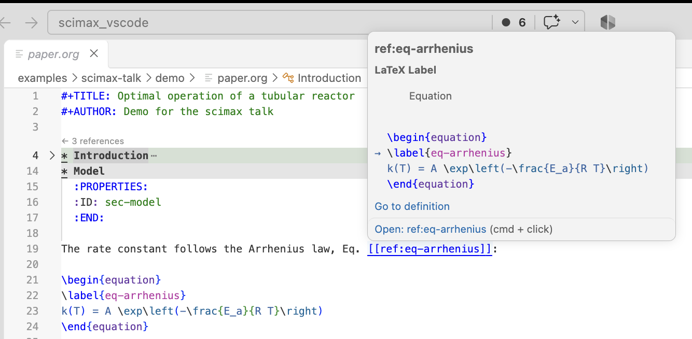
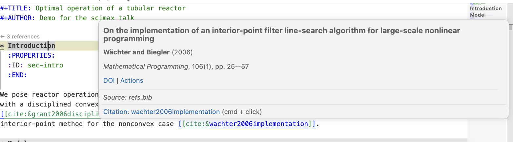
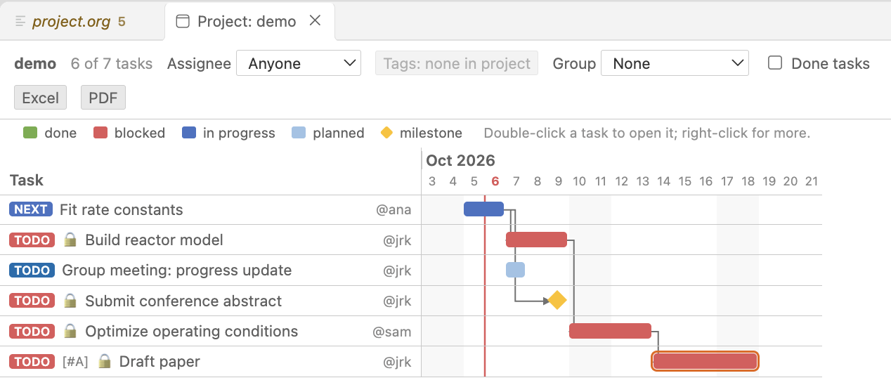

<div class="banner">

<div class="titles">

# scimax for VS Code

<p class="tagline">Structured plain text for scientists and engineers</p>
<p class="authors">John R. Kitchin <span>·</span> Department of Chemical Engineering <span>·</span> Carnegie Mellon University</p>

</div>
<div>

<div class="qrcap">github.com/jkitchin/scimax_vscode</div>
</div>
</div>

<div class="lede">

Your notes, papers, code, data and plans live in **plain text you own**. scimax makes the editor **understand their structure** (headings, tasks, citations, equations, code), so you write once and then **search it, run it, schedule it, publish it and present it**. It brings the Emacs scimax and org-mode experience to VS Code, with no Emacs required.

</div>

<div class="grid">
<div class="col">
<div class="card">

## Why plain text?

- **Diffable:** `git` sees every change
- **Greppable:** every tool can read it
- **Durable and portable:** readable in 30 years, no lock-in
- **Structured:** headings, lists, tables and code are just text conventions

### Three formats, one toolkit

org-mode, Markdown/MyST and LaTeX share navigation, citations, search and export.

</div>
<div class="card">

## Structure-aware editing


<p class="cap">An org file with folding, tables and TODO states.</p>

- **Speed commands** at headings
- **Tables** with spreadsheet formulas
- **Timestamps**, repeaters, clocking
- **Live LaTeX** preview and entities

</div>
<div class="card amber grow">

## Executable documents

```org
#+BEGIN_SRC jupyter-python :session main
import numpy as np
np.linspace(0, 1, 5).mean()
#+END_SRC

#+RESULTS:
: 0.5
```

- `C-c C-c` runs a block; results land in the document
- Python, R, Julia, shell, SQL, JS/TS, or **any Jupyter kernel**; tangling and noweb for literate programs

</div>
</div>

<div class="col">
<div class="card">

## Scientific publishing


<p class="cap">Hover a citation for the full reference.</p>

- Citations from **BibTeX**, a **DOI** (OpenAlex) or **Zotero**
- `cite:&key`, `[@key]` and `{cite:t}`, in any **CSL** style
- Labelled equations, figures and tables; references link and preview on hover

| Output  | Route              | Good for             |
|---------|--------------------|----------------------|
| PDF     | LaTeX              | Journals, theses     |
| DOCX    | Pandoc             | Collaborators        |
| HTML    | Built-in exporter  | Web, supporting info |
| ipynb   | Jupyter exporter   | Notebooks            |
| Website | `scimax publish`   | Books, course notes  |

</div>
<div class="card grow">

## Every file, indexed

- **SQLite** index of headings, tasks, code blocks and text
- **Full-text** search (FTS5, BM25 ranking)
- **Semantic** search with local Ollama embeddings: notes never leave your machine
- **Hybrid** search fuses both by reciprocal rank fusion

### CLI and AI agent skills

The same index powers the editor, the `scimax` CLI and agent skills for Claude Code, Copilot, Codex and Cursor.

```bash
scimax search "activation energy"
scimax agenda today
scimax db sync    # cron-friendly
```

</div>
</div>

<div class="col">
<div class="card">

## Agenda and projects


<p class="cap">Task dependencies drawn as a Gantt chart.</p>

- Tasks live **in your notes**, with deadlines, schedules and warning periods
- Day to month **agenda** over every file
- **Dependencies**, assignees, Gantt and a drag-and-drop project view
- **Journal** and **capture** templates, all indexed

</div>
<div class="card">

## Presentations with Marp

- Slides are **Markdown**; slide sorter and menus to edit them
- Present in the browser: **pen**, **laser**, **notes**, timer
- **Live Python** cells run in the browser with Pyodide
- One self-contained HTML file, or PDF and PPTX
- *This poster is a Marp deck too.*

</div>
<div class="card amber grow">

## Built with Claude Code

Tested, and audited for security and performance.

<div class="stats">
<div class="stat"><b>230k</b><span>lines of TypeScript</span></div>
<div class="stat"><b>4,000+</b><span>unit tests</span></div>
<div class="stat"><b>1,541</b><span>commands</span></div>
<div class="stat"><b>58</b><span>documentation files</span></div>
</div>

</div>
</div>
</div>

<div class="foot">
<div><b>Install:</b> download the VSIX from GitHub releases, then <i>Extensions: Install from VSIX…</i></div>
<div>MIT license · <b>github.com/jkitchin/scimax_vscode</b></div>
</div>
